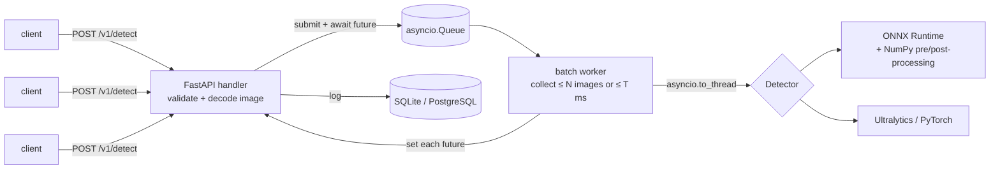

# Drone Detection API

[](https://github.com/khachaturnalbandyan/drone-detection-api/actions/workflows/ci.yml)

Production-style serving for the YOLOv8 drone detector from
[**drone-detection**](https://github.com/khachaturnalbandyan/drone-detection).
That repo trains the model; this one turns it into a web service.

**What it shows**

- **FastAPI** service with typed request/response schemas and auto-generated OpenAPI docs
- **ONNX Runtime backend with hand-written pre/post-processing** (letterbox, YOLOv8 output decoding, NMS in NumPy). No PyTorch at runtime; outputs match Ultralytics exactly (see [Results](#results))
- **Dynamic micro-batching** with `asyncio`: concurrent requests are grouped into one model call
- **Prediction log** in SQL via async **SQLAlchemy 2.0**: SQLite locally, **PostgreSQL** in Docker Compose
- **Docker** image (non-root, health check) and **GitHub Actions** CI (lint, tests on 3.11/3.12, image build)
- **Tests** for the math (NMS, coordinate mapping), the batcher (grouping, timeouts, error isolation) and the HTTP API

## Architecture



1. The handler validates the upload (size limit, decodable image) and calls `batcher.submit(image)`.
2. `submit` puts `(image, future)` on a queue and awaits the future, so the event loop stays free.
3. A single worker task takes the first queued image, then collects more until it has
   `max_batch_size` images or `max_wait_ms` has passed.
4. The blocking model call runs in a thread (`asyncio.to_thread`); each future gets its own result.
5. The handler stores the prediction (boxes, latency, backend) and returns JSON.

## Project layout

```
app/
  main.py         FastAPI app factory, endpoints, startup/shutdown (lifespan)
  batching.py     MicroBatcher: asyncio queue + batch worker
  detectors.py    Detector interface; ONNX, PyTorch and fake backends
  processing.py   letterbox, tensor conversion, YOLOv8 decoding, NMS (NumPy)
  db.py           SQLAlchemy model + async engine
  schemas.py      Pydantic response models
  config.py       settings from DDA_* environment variables
scripts/
  export_onnx.py  .pt -> .onnx with dynamic batch dimension
  benchmark.py    PyTorch vs ONNX: output parity, latency, throughput
  load_test.py    concurrent HTTP load against a running server
tests/            pytest suite (runs without model weights)
```

## Quick start

### 1. Get the model

Copy `best.pt` from your **drone-detection** training run into `models/`, then export it:

```bash
pip install -r requirements-export.txt     # ultralytics + torch, only needed for export
python scripts/export_onnx.py --weights models/best.pt   # -> models/best.onnx
```

### 2a. Run with Docker Compose (API + PostgreSQL)

```bash
docker compose up --build
```

### 2b. Or run locally (SQLite)

```bash
pip install -r requirements.txt
uvicorn app.main:app --reload
```

Open http://localhost:8000/docs for interactive docs.

### 3. Call it

```bash
curl -F "file=@drone.jpg" http://localhost:8000/v1/detect
```

Example response (values illustrative):

```json
{
  "id": 1,
  "width": 1280,
  "height": 720,
  "backend": "onnx",
  "latency_ms": 41.7,
  "detections": [
    {"box": {"x1": 612.3, "y1": 201.8, "x2": 688.0, "y2": 247.5},
     "confidence": 0.87, "class_id": 0, "class_name": "drone"}
  ]
}
```

| Endpoint | Description |
|---|---|
| `POST /v1/detect` | multipart image upload → detections in original-image pixels |
| `GET /v1/predictions?limit=20&only_with_detections=true` | recent predictions, newest first |
| `GET /health` | status, active backend, batch size |

## Configuration

All settings are environment variables (see [`.env.example`](.env.example)):

| Variable | Default | Meaning |
|---|---|---|
| `DDA_BACKEND` | `onnx` | `onnx`, `torch` or `fake` |
| `DDA_MODEL_PATH` | `models/best.onnx` | `.onnx` for the onnx backend, `.pt` for torch |
| `DDA_CONF_THRESHOLD` | `0.4` | minimum confidence |
| `DDA_IOU_THRESHOLD` | `0.45` | NMS IoU threshold |
| `DDA_MAX_DETECTIONS` | `3` | max boxes per image |
| `DDA_MAX_BATCH_SIZE` | `8` | max images per model call |
| `DDA_MAX_WAIT_MS` | `10` | how long the worker waits to fill a batch |
| `DDA_MAX_UPLOAD_MB` | `10` | upload size limit |
| `DDA_DATABASE_URL` | SQLite file | e.g. `postgresql+asyncpg://user:pw@host/db` |

## Results

Measured with `scripts/benchmark.py` on **YOLOv8s (COCO weights)** and Ultralytics' sample images,
on a **2-core cloud CPU**. These numbers show the method, not GPU performance.
Re-run them with your own model and GPU (`pip install onnxruntime-gpu` for CUDA).

**Correctness:** 8/8 PyTorch detections matched by the ONNX backend, mean IoU **1.000**.
This shows the NumPy letterbox, decoding and NMS reproduce Ultralytics' pipeline.

| backend | batch | ms / batch | images / s |
|---|---:|---:|---:|
| torch | 1 | 253.3 | 3.9 |
| onnx | 1 | 232.4 | 4.3 |
| torch | 4 | 1428.9 | 2.8 |
| onnx | 4 | 698.9 | 5.7 |
| torch | 8 | 2653.3 | 3.0 |
| onnx | 8 | 1554.2 | 5.1 |

ONNX Runtime is **1.1× faster at batch 1 and ~2× faster at batch 4–8** than PyTorch on CPU.

**End-to-end HTTP** (`scripts/load_test.py`, 48 requests, 16 concurrent, same CPU):

| `max_batch_size` | throughput | p50 latency |
|---:|---:|---:|
| 1 | 5.1 req/s | 3.07 s |
| 8 | 5.0 req/s | 2.99 s |

On a 2-core CPU, batching does **not** raise throughput, because compute is already saturated
at batch 1. Batching pays off on a GPU, where a batch of 8 costs far less than 8 single calls.
Measuring this tells you when the optimisation is worth turning on.

## Design decisions

- **ONNX by default, PyTorch optional.** The runtime image needs only `onnxruntime`, `numpy` and
  `opencv-python-headless`, a fraction of a CUDA PyTorch install. The torch backend stays as a
  reference implementation for parity checks.
- **One process, one model, one batch worker.** Several uvicorn workers would each load their own
  copy of the model and split traffic so batches never fill. Scale out with containers instead.
- **Class-aware NMS in one pass** by offsetting boxes per class, so different classes never
  suppress each other (relevant once more classes than `drone` are added).
- **Bounded upload reads** (`read(limit + 1)`) reject oversized files without loading them fully.
- **Detector interface + fake backend** keeps tests and CI fast and independent of model weights.
- **`create_all` instead of migrations** keeps the project small; Alembic is the next step for schema changes.

## Testing

```bash
pip install -r requirements-dev.txt
pytest -v
```

With real weights present you can also run the parity test:

```bash
DDA_TEST_PT=models/best.pt DDA_TEST_ONNX=models/best.onnx pytest tests/test_onnx_parity.py
```

## Possible next steps

- Video/RTSP stream endpoint with frame skipping
- Prometheus metrics (`/metrics`: latency histogram, batch-size distribution)
- TensorRT / FP16 export for the GPU
- Alembic migrations, API keys, rate limiting

## Author

Khachatur Nalbandyan · [GitHub](https://github.com/khachaturnalbandyan)
